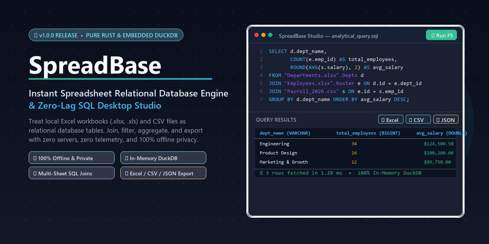

<div align="center">
  
  
  # SpreadBase
  
  **Instant Spreadsheet Relational Database Engine & Zero-Lag SQL Studio**

  [](LICENSE)
  [](#)
  [](https://github.com/Bandetheighteen/SpreadBase/releases)
  [](https://www.rust-lang.org/)
  [](https://duckdb.org/)
  [](#)
</div>

Spreadsheets run modern business operations, yet analyzing them remains remarkably clunky. When you need to join multiple sheets, reconcile messy CSV exports, or run group-by aggregations across tens of thousands of rows, Microsoft Excel formulas (`VLOOKUP`, `INDEX/MATCH`, `XLOOKUP`) become slow, brittle, and prone to silent reference errors. Cloud SQL services and SaaS tools solve the query problem but require uploading sensitive customer, payroll, or business numbers to remote servers. Setting up local PostgreSQL or MySQL instances requires running Docker containers, writing custom DDL schemas, and managing database connections.

**SpreadBase** is a standalone, 100% offline desktop application built in pure Rust. It turns local Excel workbooks (`.xlsx`, `.xls`) and CSV files into an in-memory relational database. Each sheet becomes an independent table, column headers become variables, and you query your data using standard analytical SQL (`JOIN`, `GROUP BY`, window functions, common table expressions). When finished, export your query results back to Excel, CSV, or JSON with a single click.

---

## 📥 Downloads & Releases

Get the standalone pre-compiled executable for Windows:

| Platform | Architecture | Package Format | Direct Download | File Size |
|---|---|---|---|---|
| **Windows 10 / 11** | `x86_64` | Standalone Portable Binary (`.exe`) &bull; **v1.0.0** | [**Download SpreadBase (v1.0.0)**](https://github.com/Bandetheighteen/SpreadBase/releases/download/v1.0.0/SpreadBase-v1.0.0-windows-x86_64.exe) <br/> *(or from repo: [`release/SpreadBase-v1.0.0-windows-x86_64.exe`](release/SpreadBase-v1.0.0-windows-x86_64.exe))* | 38.9 MB |

> 🚀 **SpreadBase Version 1.0 (v1.0.0) is officially live!**
> The executable is completely self-contained with no external runtime dependencies: no Python runtime, no Java Virtual Machine, and no local database services required. Download, double-click, and start querying.
> 
> 📌 **Looking for all releases and tags?** Visit the **[GitHub Releases Page](https://github.com/Bandetheighteen/SpreadBase/releases)**.

---

## ✨ Key Features

- **Multi-Sheet Workbook Ingestion:** Open one or multiple Excel workbooks (`.xlsx`, `.xls`) and CSV files simultaneously. Every worksheet is registered as a relational table, namespaced cleanly as `"filename.xlsx".SheetName`.
- **Zero-Copy In-Memory Engine:** Backed by an embedded, in-process DuckDB analytical SQL engine. Queries execute against columnar vectors in memory at microsecond speeds without writing temporary database files to disk.
- **Cross-File Relational Joins:** Join an Excel sheet from a financial model with a raw CSV export from Stripe or Salesforce using standard ANSI SQL syntax.
- **Interactive Schema Explorer:** The left sidebar displays an expandable hierarchy of all loaded files, tables, columns, and inferred data types (`VARCHAR`, `BIGINT`, `DOUBLE`, `BOOLEAN`, `TIMESTAMP`). Clicking any table automatically populates a query template in the editor.
- **SQL Editor with Immediate Diagnostics:** Monospace multi-line SQL editor supporting comment lines, multi-statement queries, selection-only execution, and global shortcuts (`F5` or `Ctrl+Enter`). Syntax errors surface in a red diagnostic banner with exact parser error messages.
- **High-Performance Virtualized Results Grid:** Powered by `egui_extras::TableBuilder`. Scrolls through 50,000+ rows smoothly at 60 FPS by rendering only visible viewport rows. Distinct styling for SQL `NULL` values, alternating row fills, and numeric right-alignment.
- **Multi-Format One-Click Export:** Persist query results into:
  - **Excel (`.xlsx`):** Formatted workbook with bold header row, preserved data types, and blank cells for nulls (via `rust_xlsxwriter`).
  - **CSV (`.csv`):** Standard RFC 4180 comma-separated records with header row and escaped special characters.
  - **JSON (`.json`):** Clean array of keyed objects for data pipelines, scripting, or web apps.
- **100% Offline & Private:** Zero internet connection required. Zero telemetry, tracking, or network requests. Confidential financial, health, and customer datasets never leave your machine.

---

## 🛠️ Architecture & Engineering

```
┌────────────────────────────────────────────────────────┐
│               SpreadBase GUI (egui / eframe)           │
│   • Toolbar (Open, Run, Export Excel/CSV/JSON)         │
│   • Left Sidebar: Schema Tree (Files, Tables, Columns) │
│   • Top-Right: Monospace SQL Editor (Selection / F5)   │
│   • Bottom-Right: Virtualized Results Grid (60 FPS)    │
└───────────────────────────┬────────────────────────────┘
                            │ crossbeam-channel
                            ▼
┌────────────────────────────────────────────────────────┐
│            Background Worker Thread (Zero Lag)          │
│   • Ingestion: calamine (Excel) + csv (CSV streaming)  │
│   • Relational Schema Inferrer & Type Reconciler       │
│   • Embedded DuckDB In-Memory Analytical Engine        │
│   • Exporters: rust_xlsxwriter, csv, serde_json        │
└────────────────────────────────────────────────────────┘
```

- **Frontend & Rendering:** Built on `egui` and `eframe` (immediate-mode graphical user interface running over `wgpu`). Instant startup time and sub-50ms user input response.
- **Engine:** In-process embedded `DuckDB` compiled from source in release mode. Supports vectorized execution, window functions, regex matching, common table expressions, and complex subqueries.
- **File Parsers:** `calamine` for fast Excel parsing across `.xlsx` and legacy `.xls` binary formats; streaming reader via `csv` crate for CSV files.
- **Concurrency Model:** Database operations, file parsing, and queries run on an isolated OS worker thread communicating over `crossbeam-channel`. The main UI thread renders continuously at 60 FPS and never stutters or hangs during multi-megabyte file ingestion.
- **Memory Safety & Portability:** Written in 100% safe Rust. Compiles to a single binary with zero external DLL requirements.

---

## 🚀 Getting Started

### Prerequisites

- **To run the pre-built application:** Windows 10 or 11 (64-bit). No dependencies required.
- **To build from source:** 
  - [Rust 1.80+ and Cargo](https://www.rust-lang.org/tools/install)
  - C++ build tools (Visual Studio C++ Build Tools on Windows, or GCC/Clang on Unix)

### Build from Source

```bash
# 1. Clone the repository
git clone https://github.com/Bandetheighteen/SpreadBase.git
cd SpreadBase

# 2. Run the test suite (14 unit and integration tests)
cargo test

# 3. Launch in development mode
cargo run

# 4. Compile the optimized standalone production release binary
cargo build --release
```

The compiled release executable will be located at:
```
target/release/spreadbase.exe
```

---

## 💡 Usage Guide

### 1. Open Your Data Files
Click **📂 Open File** on the top toolbar. Select one or more `.xlsx`, `.xls`, or `.csv` files from your computer.

### 2. Inspect the Discovered Schema
The left sidebar lists your files. Expand any file to see its sheets (tables) and column definitions with their detected types:
```
📁 Sales_Q3.xlsx
   ├── 📑 Orders (order_id: BIGINT, customer_id: BIGINT, total: DOUBLE)
   └── 📑 LineItems (item_id: BIGINT, order_id: BIGINT, sku: VARCHAR, qty: BIGINT)
📄 Customers.csv
   └── 📑 Customers (customer_id: BIGINT, name: VARCHAR, state: VARCHAR)
```

### 3. Write and Execute SQL Queries
Type your SQL query into the editor. Press **▶ Run Query**, hit `F5`, or press `Ctrl + Enter`.

#### Example: Cross-File Join with Aggregation
```sql
SELECT 
    c.state,
    COUNT(DISTINCT o.order_id) AS total_orders,
    ROUND(SUM(o.total), 2) AS total_revenue,
    ROUND(AVG(o.total), 2) AS avg_order_value
FROM "Sales_Q3.xlsx".Orders o
JOIN "Customers.csv".Customers c 
    ON o.customer_id = c.customer_id
WHERE o.total > 0
GROUP BY c.state
ORDER BY total_revenue DESC;
```

#### Example: Running a Selection
Highlight only the lines or subquery you wish to execute, and press `F5`. SpreadBase will execute only your highlighted text fragment.

### 4. Export Your Results
When the query finishes, the **📊 Export Excel**, **💾 Export CSV**, and **📄 Export JSON** buttons illuminate on the toolbar. Click any button to open a native save dialog and save the file to your disk.

---

## ⌨️ Keyboard Shortcuts

| Shortcut | Action |
|---|---|
| `F5` | Execute active query or selected text fragment |
| `Ctrl + Enter` | Execute active query or selected text fragment |
| `Single Click` (Sidebar Table) | Auto-populate `SELECT * FROM "{table}" LIMIT 100;` into editor |
| `Double Click` (Sidebar Column) | Inspect column data type |

---

## 🗺️ Roadmap

- [x] Multi-sheet Excel (`.xlsx`, `.xls`) ingestion with automatic table registration
- [x] CSV ingestion with streaming header and type inference
- [x] Embedded in-memory DuckDB SQL engine
- [x] Dark IDE layout with resizable sidebar, multi-line editor, and virtualized results grid
- [x] Export to Excel (`.xlsx`), CSV (`.csv`), and JSON (`.json`)
- [x] Circular end-to-end integration test suite
- [ ] Direct Parquet file ingestion (`.parquet`)
- [ ] SQLite database file import (`.db`, `.sqlite`)
- [ ] Query history log and saved query tabs
- [ ] Native Linux (`.deb`, `.AppImage`) and macOS (`.dmg`) compilation builds

---

## 🤝 Contributing

Contributions, feature suggestions, and bug reports are warmly welcome!

1. Fork the repository (`git fork https://github.com/Bandetheighteen/SpreadBase`).
2. Create your feature branch (`git checkout -b feature/parquet-support`).
3. Commit your changes (`git commit -m 'feat: add parquet ingestion support'`).
4. Ensure all tests pass (`cargo test`).
5. Push to the branch (`git push origin feature/parquet-support`).
6. Open a Pull Request.

---

## 👨‍💻 Author

This project was built and designed by **Shounak Saha** ([@Bandetheighteen](https://github.com/Bandetheighteen)).

> *"I am a non-coder with no formal background in software engineering. I designed and built this tool from scratch to eliminate the daily frustration of writing fragile Excel lookup formulas and setting up heavy database servers just to analyze local spreadsheets.*
>
> *I warmly welcome open-source developers, researchers, and data analysts to collaborate, submit pull requests, open issues, and help improve SpreadBase together!"*

- **GitHub:** [@Bandetheighteen](https://github.com/Bandetheighteen)
- **Portfolio / Connect:** [linktr.ee/shounaksaha2000b](https://linktr.ee/shounaksaha2000b)

---

## 📄 License

SpreadBase is dual-licensed under either:

- **[MIT License](LICENSE-MIT)** &copy; 2026 **Shounak Saha** ([@Bandetheighteen](https://github.com/Bandetheighteen))
- **[Apache License, Version 2.0](LICENSE-APACHE)** &copy; 2026 **Shounak Saha** ([@Bandetheighteen](https://github.com/Bandetheighteen))

at your option.

Unless you explicitly state otherwise, any contribution intentionally submitted for inclusion in the work by you shall be dual-licensed as above, without any additional terms or conditions.
